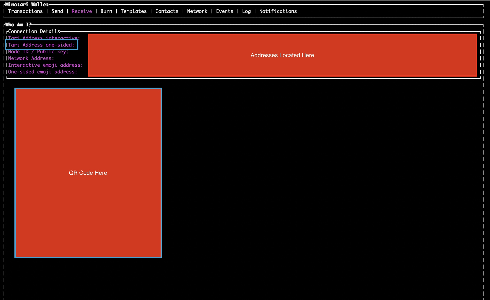

- [Introduction](#introduction)
- [Proposed Integration Structure](#proposed-integration-structure)
- [MinoTari Versions & Release Methodology](#minotari-versions--release-methodology)
- [Setting up Minotari](#setting-up-minotari)
  - [Download the Minotari Binaries and Set Up Your Base Node](#section-1-download-the-minotari-binaries-and-set-up-your-base-node)
- [Create and Configure your Wallets](#create-and-configure-your-wallets)
  - [Creating the Deposit/Main Wallet](#section-2-creating-the-depositmain-wallet)
  - [Obtain the addresses of the Deposit/Main wallet](#section-3-obtain-the-addresses-of-the-depositmain-wallet)
  - [Setting Up a Read-Only Wallet to Monitor for Transactions and Receive Deposits](#section-4-setting-up-a-read-only-wallet-to-monitor-for-transactions-and-receive-deposits)
  - [Configuring the read-only wallet](#section-5-configuring-the-read-only-wallet)
  - [Listening for incoming transactions](#section-6-listening-for-incoming-transactions)
- [Descriptions of Common Activities](#descriptions-of-common-activities)
  - [Receiving funds / User Deposits](#receiving-funds--user-deposits)
  - [Performing withdrawals](#performing-withdrawals)
  - [Confirming Deposits and Withdrawals](#confirming-deposits-and-withdrawals)
- [Payment Reference (PayRef) Integration](#payment-reference-payref-integration)
  - [What are Payment References?](#what-are-payment-references)
  - [How PayRefs Work](#how-payrefs-work)
  - [PayRef Integration Examples](#payref-integration-examples)
    - [Section 9: Verifying Customer Deposits with PayRefs](#section-9-verifying-customer-deposits-with-payrefs)
    - [Implementation Example](#implementation-example)
    - [Customer Support Workflow](#customer-support-workflow)
    - [Section 10: Automated PayRef Processing](#section-10-automated-payref-processing)
  - [Best Practices for Exchanges](#best-practices-for-exchanges)
    - [Security Considerations](#security-considerations)
    - [Customer Experience](#customer-experience)
    - [Integration Checklist](#integration-checklist)
    - [PayRef Customer Support Templates](#payref-customer-support-templates)
      - [Email Templates](#email-templates)
    - [Error Handling and Edge Cases](#error-handling-and-edge-cases)

# Introduction
In this guide, we will cover the details of exchange integration, including:

- The proposed configuration, transaction flow and structure of the integration.
- The release methodology and the distinction between our production, testing and development chains. 
- Setting up a MinoTari node and the wallets required to operate an exchange.
- Configuring the node and wallets for exchange use in common scenarios.
- The Tari Address structure and validating Tari Addresses
- How to create unique addresses for your customers to deposit funds without requiring individual user wallets.
- How to monitor for blockchain for transactions.
- How to use Payment Reference for deposit and transaction confirmation
- An explanation of transaction information returned by the available gRPC methods

> Note: while references to GRPC methods and code examples will be provided here, readers should refer to the [API GRPC Explanation](./API_GRPC_Explanation.md) guide for a full breakdown of the available gRPC methods and their implementation.

This guide assumes that the node will not be used for mining.

# Proposed Integration Structure
Below is the proposed structure of the integration.


* A cold wallet that is the primary wallet for storage of deposit funds. This wallet should be airgapped to be kept entirely separate of the online infrastructure. This is the **Main Wallet** 
* A read-only hot wallet that is used to monitor for incoming transactions to the exchange. This uses the private view key and public spend key from the cold wallet. This is the **Monitoring Wallet** that scans for incoming transactions.
* A **MinoTari base node**. This provides access to the full blockchain on the exchange and removes the reliance on third-parties or public nodes.
* A third, optional hot wallet used for withdrawals. This would be filled periodically with funds transferred from the main wallet, removing the need for the **Main Wallet** to be used for user withdrawals. 

This provides a reasonable environment for monitoring for user deposits and withdrawals.

# MinoTari Versions & Release Methodology

MinoTari has three different networks:
- **Mainnet**: This is the main network.
- **NextNet**: This is the test network, and should be used for testing and development.
- **Esmeralda**: A development network with a deliberately low difficulty target for mining. However, due to frequent resets, should only be used for localised, rapid testing scenarios that don't rely on a large amount of historical data.

MinoTari releases follow the below methodology, and you should use the version appropriate to the network that you are interested in.
 
- **Mainnet (Stable)**: no suffix, e.g. v2.0.1 (example; always verify the latest) 
- **Nextnet (Release Candidate)**: suffix -rc.#, e.g. v2.0.1-rc.0 
- **Esmeralda (Pre-Release)**: suffix -pre.#, e.g. v2.0.1-pre.0 

Example Convention: 
- 4.2.0 → Mainnet
- 4.2.0-rc.0 → Nextnet
- 4.2.0-pre.0 → Esmeralda 

Official binary releases can be found on the GitHub project release page at [github.com/tari-project/tari/releases](github.com/tari-project/tari/releases)

# Setting up Minotari
You will require the following CLI tools from the release to set up MinoTari:
- `minotari_node`
- `minotari_console_wallet`

You will need a Minotari node with gRPC methods enabled. While it is possible to use a public node with the correct gRPC methods exposed, it is recommended that you run your own node for full control and auditability.

> Note: For all servers connected to the internet, they must either be running a Tor client or configure their public IP information. Documentation on this is available [here](https://github.com/tari-project/tari#README) and [here](https://github.com/tari-project/tari/discussions/6366). If you are running on Linux, the Tari applications have built-in Tor support, so this can be ignored.

# Section 1: Download the Minotari Binaries and Set Up Your Base Node 

> NOTE: If you are using a public Minotari node, you can skip this section. Note that you will need the `public key` and the `public address` of the public node in question in order to correctly proceed with this exchange guide.

The latest version of Minotari can be found here: [https://github.com/tari-project/tari/releases](https://github.com/tari-project/tari/releases). Exchanges interested in the build process can review the associated GitHub Actions for the `Build Matrix of Binaries`.

2. Use the instructions here to [install the binaries](https://github.com/tari-project/tari?tab=readme-ov-file#installing-using-binaries).

> NOTE: Depending on your environment, the location of the installed files will likely change. For Mac and Linux, you will likely find it in your Home directory in a `.tari` folder. It may be hidden, in which case you will need to change your settings to be able to view hidden files. On Windows, it will install on in the location you specified during the installation process. To have Minotari create the folder in a specific location, you can use the `--b` path command. Note that you will require this command going forward if you are not using the default folder.

The following binaries will be available.

* **minotari_console_wallet**
* minotari_merge_mining_proxy
* minotari_miner
* **minotari_node**
* randomx-benchmark
* randomx-codegen
* randomx-tests

The two required for the exchange are the **minotari_node** and **minotari_console_wallet**

3. Start the node (consecutive runs): 
```
./minotari_node
```

This can be run with a number of different arguments. The most notable are `--help` and `-b ./path`, where you specify the location of a custom base path. This command is particular useful if you want to create wallets with distinct configuration folders. 

If a node has not yet been created, it will inform you that a node config file does not exist. You will also be asked if you wish to mine. Select `n` in this case.

4. Next, you'll be asked if you wish to create a node identity. Select `y`. This is essential for generating the private/public key pair and getting the node recognised by the network.

Once done, the Minotari base node will boot up. You'll see a splash page with a list of the various Command Mode (accessible via Ctrl+C) commands available to you. Some useful ones are:

* `watch status`: returns you to the auto-refresh status from the Command Mode
* `version`: which version of the Minotari Node you are running
* `whoami`: provides address information related to the node

5. Type `whoami` and press enter. You'll see your Public Key, Node ID and Public Address, along with a QR Code. You should copy this data to a file or secure location for future reference.

```
18:46 v1.0.0-pre.16 esmeralda State: Listening Tip: 3872 (Tue, 23 Jul 2024 14:27:53 +0000) Mempool: 0tx (0g, +/- 0blks) Connections: 0|0 Banned: 0 Messages (last 60s): 0 Rpc: 0/100 ️🔌
>> whoami
Public Key: 90f67a04edcb36261e6304ca213629d183c44e26bd47e38c253473f44d901733
Node ID: e8ed9a4fd38577b6b01e3b8e9d
Public Addresses: /onion3/f5qbkkfkoxowzvshe5mppzpgiiy76cwumpsacungeldoal6hehcgzfqd:18141
Features: PeerFeatures(MESSAGE_PROPAGATION | DHT_STORE_FORWARD)
```

6. Restart the node (Ctrl+C twice to quit, then typing `minotari_node` again).

# Section 2: Creating the Deposit/Main Wallet
In this section we'll create a wallet address for receiving funds. This wallet will serve as the main repository of your Tari coins.

> NB: This is a crucial step in the process. Creating the wallet in secure environment and following the instructions is important to secure this wallet and prevent malicious actors being able to transfer Tari. Read the instructions carefully. If there is any doubt regarding ANY part of the process, please contact the Tari Community for clarification and assistance.

The Minotari wallet creation process is reliant on a seed word phrase to generate the associated master key. This seed phrase also allows for the recovery of the wallet. The seed phrase is a 24-word phrases generated from a pre-defined list of words, which will be displayed during the process.

> **WARNING: It is highly recommended this process is performed on a trusted machine that is disconnected from any other device or the Internet. The utmost caution should be taken in creating the wallet and noting and securing the seed phrase.**

1. First, let's create a folder to hold all the wallet data.
```
mkdir tari_wallet_data
cd tari_wallet_data
```

> Note: At multiple points in the sections covering the creation of the wallets, you will be directed to copy or note seed phrases, keys and other information. Do not store any of these within the created folder above, as you will need to delete this folder permanently in later steps.

2. Now let's run the wallet. Make sure that you specify the `--base-path` field to keep all the data in the above folder so that you can delete it afterwards.
```
minotari_console_wallet --base-path ~/tari_wallet_data
```

3. You'll be presented with a menu. As this guide assumes you are setting up Minotari for the first time, select `1`

```
Console Wallet

1. Create a new wallet.
2. Recover wallet from seed words or hardware device.
3. Create a read-only wallet using a view key.
>>
```

4. You will be asked if you want to mine. Choose `n`

```
Node config does not exist.
Would you like to mine (Y/n)?
NOTE: this will enable additional gRPC methods that could be used to monitor and submit blocks from this node.
```

5. You will be asked if you wish to use a connected hardware wallet. Press `n` here.

```
Would you like to use a connected hardware wallet? (Supported types: Ledger) (Y/n)
```

6. Next you will be asked for a password. You will need to save this password for future use. Enter this password now, and then again to confirm it. Be meticulous when doing so. We recommend following best practices to generating a strong password.

> NOTE: You will not see the password as you type it.

7. **This next step is vital. Be sure that no information leaks and that the seed phrase is only visible to yourself and/or trusted parties.** Following entry of the password, you will be presented with your seed words. Carefully note the seed words, write them down and secure them. Make sure you have appropriate, equally secure backups. You will only be able to proceed to the next step once you have typed `confirm` and pressed `Enter`.

```
=========================
       IMPORTANT!        
=========================
These are your wallet seed words.
They can be used to recover your wallet and funds.
WRITE THEM DOWN OR COPY THEM NOW. THIS IS YOUR ONLY CHANCE TO DO SO.

=========================
<...............seed words will be presented here.............>
=========================

I confirm that I will never see these seed words again.
Type the word "confirm" to continue.
>>
```

8. At this point, the Minotari wallet will launch in the console interface.

> Note: The following sections deal with configuration of the wallet. While not necessary, an extra safety precaution would be to confirm that the seed words you copied can actually recover the wallet.

# Section 3: Obtain the Addresses of the Deposit/Main Wallet

Now that we have the wallet created, we will require the addresses - specifically, the `Tari Address one-sided` - to create the second wallet, which will be used to monitor transactions.

If you followed the instructions from the previous section, you should already be in the Minotari console wallet interface. If not, run `minotari_console_wallet --base-path ~/tari_wallet_data` and enter in your password to launch the interface.

1. While in the wallet interface, press the right arrow twice to get to the `Receive` tab. This tab will list all of the addresses associated with the wallet.



2. Copy all of the information provided, with special note of the `Tari Address one-sided` field. This is the address that users will send funds to for the exchange.

3. Press `f10` or `Ctrl+Q` to exit the wallet

4. Next, we'll export the view key for the wallet (We'll use this in **Section 4**). Run the following command and enter in your wallet password when prompted.

```
minotari_console_wallet --base-path ~/tari_wallet_data export-view-key-and-spend-key
```

You'll be presented with information that looks similar to the below:

```
1. ExportViewKeyAndSpendKey(ExportViewKeyAndSpendKeyArgs { output_file: None })

View key: cb6c13f07af23380c7756bbfcd622bc3277ec2cc42abd5ed3d8ddd19fa49060c
Spend key: f29039796b3430c6927f26bf216b6241dd7fad7f30a6640e8ac95f3d0af51a52
Minotari Console Wallet running... (Command mode completed)

Press Enter to continue to the wallet, or type q (or quit) followed by Enter.
```

5. Make note of the `view key` and `spend key`; copy them to an easily referenced place. We will require them in later steps.

6. Type `q` and then press `Enter` to exit the console wallet.

7. Make sure you have saved the above data. Permanently delete the folder `tari_wallet_data` and consider destroying or securely wiping the machine.

> Note: Now is a good time to check your noted keys, seed words and addresses before remove the configuration data in the folder and/or destroying/wiping the device.

# Section 4: Setting Up a Read-Only Wallet to Monitor for Transactions and Receive Deposits
In this section, we will create a second, read-only wallet that will watch for funds received at the address saved in the previous section. If you are integrating an exchange, this is how you can watch for received funds. This wallet will need to be able to access the Internet in some capacity.

> NOTE: This second wallet will not have the ability to spend any funds. While this limits the security risk, it is good practice to maintain security best practices when configuring any system that has access to the chain and has some association with the the main wallet.

1. On a server machine that is connected to the internet. Run this command `minotari_console_wallet` to create a wallet.

> Note: By default all data is stored in `~/.tari`. You can find all logs, config and data in there. If you would like to use a specific folder, you can use the `--base-path` argument to point to an existing folder or one you've created prior for this purpose.

2. You will be asked if you want to mine. Choose `N`

```
Node config does not exist.
Would you like to mine (Y/n)?
NOTE: this will enable additional gRPC methods that could be used to monitor and submit blocks from this node.
```

3. Next, you will be asked if you want to create a new wallet, restore it, or create a read-only wallet using a view key. We want to create a _read-only wallet_, so we will select `3` here.

```
Console Wallet

1. Create a new wallet.
2. Recover wallet from seed words or hardware device.
3. Create a read-only wallet using a view key.
>>
```

4. Next we will be asked for a password. You will need to save this password for future use. Enter this password now and confirm it. 

> Note: It is suggested you use a different password here from the one used to create the first wallet.

5. You will need to enter the view and spend keys noted in **Section 4**

```
Enter view key:  (hex)
<...view key here...>

Enter the public spend key:  (hex or base58)
<...public spend key here...>  
```

6. You should now see the familiar console wallet. We'll need to configure it further in its accompanying configuration file, so close it for now by pressing `f10` or `Ctrl+Q` and move onto the next section.

## Section 5: Configuring the read-only wallet
1. Browse to the config file under `~/.tari/mainnet/config/config.toml` (or the folder where you specified the wallet configuration should be stored) and open it in your favourite text editor.

2. Find the section `Wallet Configuration Options (WalletConfig)`. Below is a typical example of the beginning of the wallet configuration section within the `config.toml` file.

```toml
########################################################################################################################
#                                                                                                                      #
#                      Wallet Configuration Options (WalletConfig)                                                     #
#                                                                                                                      #
########################################################################################################################

[wallet]
# The buffer size constants for the publish/subscribe connector channel, connecting comms messages to the domain layer:
# (min value = 300, default value = 50000).
#buffer_size = 50000is
```

3. Next, find the line `#grpc_enabled = false` and change it to `grpc_enabled = true`. You will also need to uncomment the `grpc_address`.

> Note: If you wish to secure the gRPC more, you can edit the other settings, such as the `grpc_authentication`. It is important that the wallet's gRPC port is not accessible from the public internet

```toml
# Set to true to enable grpc. (default = false)
grpc_enabled = true
# The socket to expose for the gRPC base node server (default = "/ip4/127.0.0.1/tcp/18143")
grpc_address = "/ip4/127.0.0.1/tcp/18143"
# gRPC authentication method (default = "none")
#grpc_authentication = { username = "admin", password = "xxxx" }
```

> Note: Also set `num_confirmations_required` under both `[wallet.transactions]` and `[wallet.outputs]` to your `REQUIRED_CONFIRMATIONS` (see [Block Confirmations](#block-confirmations); recommended 10). The default is 3.

4. Set the wallet's base node. By default the Tari provided public server will be used, but it can also be set to a private base node. Set this value to the `minotari_node` you created or chose at the beginning of this guide in **Section 1**.

> Note: Below is a sample of what these configuration settings look like, using the example data from **Section 1**. You should not use the data below, but insert your own details.

This is the private base node:
```toml
# Wallet Query HTTP service details
# `external_address` is optional, but if not set, then wallet wont be able to call our endpoint.
# This address must be accessible by the wallet (on a global scale over the internet).
[base_node.http_wallet_query_service]
#port = 9000
#listen_ip = "0.0.0.0"
#external_address = "http://127.0.0.1:9000"
```

This is the fallback base node, which can also be a private base node.
```toml
# The URL of the HTTP client to use for base node service requests
#http_server_url="http://127.0.0.1:9000"
# The fallback url address to use if the base node at http_server_url does not respond
#fallback_http_server_url = "https://rpc.tari.com"             # MainNet
#fallback_http_server_url = "https://rpc.stagenet.tari.com"    # StageNet
#fallback_http_server_url = "https://rpc.nextnet.tari.com"     # NextNet
#fallback_http_server_url = "https://rpc.localnet.tari.com"    # LocalNet
#fallback_http_server_url = "https://rpc.igor.tari.com"        # Igor
#fallback_http_server_url = "https://rpc.esmeralda.tari.com"   # Esmeralda
```

5. Save the file and start the wallet again.

```
minotari_console_wallet
```

You are now ready to receive deposits. In the next section we'll explain how to listen for incoming transactions.

## Section 6: Listening for incoming transactions

> The sweep and balance gates below are stop-gaps until the wallet stops reporting outputs it cannot spend, or that
> their sender can reclaim, as deposits (a separate wallet fix). After that they remain defence in depth.

How you listen for incoming transactions (and what you do with them) will depend on your process. For our example, we'll use the gRPC server that is hosted in the read-only wallet we just created to listen for incoming deposits. 

Reach out to us if you would like an example in your favourite language. You can find more information about the methods available in [wallet.proto here](https://github.com/tari-project/tari/blob/development/applications/minotari_app_grpc/proto/wallet.proto).

```javascript
const grpc = require('@grpc/grpc-js');
const protoLoader = require('@grpc/proto-loader');

// Load the protobuf
const PROTO_PATH = './proto/wallet.proto';
const packageDefinition = protoLoader.loadSync(PROTO_PATH, {
    keepCase: true,
    longs: String,
    enums: String,
    defaults: true,
    oneofs: true
});
const streamingProto = grpc.loadPackageDefinition(packageDefinition).tari.rpc;

// Create a client
console.log(streamingProto);
const client = new streamingProto.Wallet('localhost:18143', grpc.credentials.createInsecure());

// Read the whole stream first, so the pass can handle the records in a fixed order
function collectCompletedTransactions(client) {
    return new Promise((resolve, reject) => {
        const txs = [];
        const call = client.GetCompletedTransactions({});
        call.on('data', (response) => txs.push(response.transaction));
        call.on('end', () => resolve(txs));
        call.on('error', reject);
    });
}

// One pass over the wallet's transactions; run it on a schedule
async function runListenerPass() {
    const state = await getWalletState(client); // once per pass, before the stream
    const txs = await collectCompletedTransactions(client);
    // Sweeps first (see the sweep gate below)
    for (const tx of txs) {
        await recordSweep(client, tx, state);
    }
    await ledger.rebuildWithdrawable(); // alerts when a withdrawable deposit lost its confirmed sweep
    for (const tx of txs) {
        try {
            // The shared function below ignores anything it must not act on
            await creditCustomerAccount(client, tx, state);
        } catch (error) {
            console.error(`Transaction ${tx.tx_id} not processed, retried on the next pass:`, error);
        }
    }
}
```

> **Lookup errors:** a `NOT_FOUND` status means there genuinely is nothing to return. A `DATA_LOSS` status means stored
> transaction rows could not be decoded; its message is `undecodable rows: skipped=N`, paged calls add
> `offset=O limit=L`, and `GetTransactionInfo` adds the `tx_id=T` it could not decode. Do not retry it: check the
> wallet log for the affected tx ids. An `INTERNAL` status is a wallet-side fault (for example a decryption failure,
> usually a wrong key or a damaged database): retry a bounded number of times, then alert. It never means not found;
> paged calls include `offset`/`limit` in it too, so after investigating you can resume past the page.
>
> - The streaming paged call has already delivered the chunks before the failing one, so resume at `offset + limit`.
> - The unary `GetAllCompletedTransactions` returns nothing when a chunk fails, and its message also carries
>   `request_offset=R`: re-request from `request_offset` up to `offset`, then continue at `offset + limit`.
>
> The unfiltered `GetCompletedTransactions` stream leaves undecodable rows out and only logs them. Paged calls also
> leave out undecodable rows when other rows on the same page decode, so a short page is not the end of the data. Only
> the keyed lookups (by payment id, block height or hash, or PayRef) report every undecodable match as `DATA_LOSS`, so
> reconcile the other calls against them. The keyed lookups also return cancelled transactions, so filter on
> `is_cancelled`; an undecodable cancelled match still causes `DATA_LOSS`.
>
> When you get `DATA_LOSS`:
>
> 1. Take the tx id from the `DATA_LOSS` message (`tx_id=`) or from the wallet log lines `Skipping undecodable …` /
>    `… does not decode`.
> 2. Stop the wallet and back up its database.
> 3. A pending outbound transaction can be cancelled with `CancelTransaction`.
> 4. A completed transaction has to be restored from a backup written by the version that wrote it, or removed so that
>    recovery or the UTXO scan detects its inbound outputs again. Confirm this against the scanner's behaviour before
>    relying on it. Never apply this to an outbound sweep row (see the sweep gate below).

Never credit an unmatched output because someone presents its PayRef, amount or time: reconcile it against the sending
wallet's records first, and return funds only to a sender address verified out of band, out of that output's own swept
value (see Manual resolution below). Record the outcome through `ledger.creditOnce` or `ledger.markResolved` on its
`tx_id`. If a credited `tx_id` later
shows a status that is not confirmed, or `is_cancelled`, alert: it was reorged past your confirmation depth.

Credit each inbound transaction once per `tx_id`, only when it is not cancelled and is in a confirmed status (see [Confirming Deposits and Withdrawals](#confirming-deposits-and-withdrawals)), using its `amount` and `user_payment_id`. For transactions recovered from the chain, the memo-derived fields (`user_payment_id`, `raw_payment_id` and `source_address`) are written by the sender. `source_address` is informational only, and `source_address_claimed` is set when it is a sender-written address; do not use it to decide which account to credit. A PayRef identifies a mined output, but it can be computed from public chain data, so it proves neither who sent the output nor which account to credit.

All three places that credit deposits (the listener above, PayRef verification in Section 9 and the automated
processing in Section 10) should use one function, so that they share the same checks and the same ledger:

```javascript
// Statuses that count as confirmed for a deposit (see Transaction Status)
const CONFIRMED_STATUSES = ['TRANSACTION_STATUS_MINED_CONFIRMED', 'TRANSACTION_STATUS_ONE_SIDED_CONFIRMED'];
// Confirmed but time-locked: credited automatically once unlocked
const LOCKED_STATUSES = ['TRANSACTION_STATUS_MINED_CONFIRMED_LOCKED', 'TRANSACTION_STATUS_ONE_SIDED_CONFIRMED_LOCKED'];
// Coinbase outputs are never deposits (see Transaction Status)
const COINBASE_STATUSES = [
    'TRANSACTION_STATUS_COINBASE_UNCONFIRMED',
    'TRANSACTION_STATUS_COINBASE_CONFIRMED',
    'TRANSACTION_STATUS_COINBASE_NOT_IN_BLOCK_CHAIN',
    'TRANSACTION_STATUS_COINBASE_CONFIRMED_LOCKED'
];
// Your confirmation depth (see Block Confirmations)
const REQUIRED_CONFIRMATIONS = 10;

// The wallet's scanned height and balance
function getWalletState(client) {
    return new Promise((resolve, reject) =>
        client.GetState({}, (error, response) => (error ? reject(error) : resolve(response))));
}

// Whether a transaction is buried deep enough. Pass the state of the current pass, or it is fetched.
async function isDeepEnough(client, tx, state = null) {
    const current = state ?? (await getWalletState(client));
    return BigInt(current.scanned_height) - BigInt(tx.mined_in_block_height) >= BigInt(REQUIRED_CONFIRMATIONS);
}

// Coarse tripwire: credits not yet swept by a confirmed, deep sweep must be covered by what the wallet holds. Deposits
// in a sweep that is broadcast but not confirmed stay owed; the wallet still counts them in pending_outgoing_balance.
async function balanceCovers(state, extraAmount, txId) {
    const b = state.balance;
    const held = BigInt(b.available_balance) + BigInt(b.pending_outgoing_balance);
    const owed = (await ledger.unsweptCreditTotal()) + BigInt(extraAmount);
    if (owed <= held) {
        await ledger.clearGap();
        return true;
    }
    // Defer the credit. Halt only when a gap is seen on two consecutive passes and exceeds pending incoming funds.
    const gap = owed - held;
    if ((await ledger.noteGapForPass(gap)) >= 2 && gap > BigInt(b.pending_incoming_balance)) {
        await haltCreditingAndAlert({ txId, owed, held });
    }
    return false;
}

// Credit a deposit at most once. `tx` is a TransactionInfo from GetCompletedTransactions, GetTransactionInfo or
// GetPaymentByReference. Returns the credited account, or null when the transaction must not be credited (yet).
// flagUnmatchedDeposit and escalateToOperator are idempotent per tx_id and reason, as they are called on every pass.
async function creditCustomerAccount(client, tx, state = null) {
    if ((await ledger.isCredited(tx.tx_id)) && (tx.is_cancelled || !CONFIRMED_STATUSES.includes(tx.status))) {
        await escalateToOperator(tx.tx_id, `credited deposit reorged past your depth (${tx.status})`);
    }
    if (await ledger.isResolved(tx.tx_id)) {
        return null; // already credited, refunded or written off, automatically or by hand
    }
    if (tx.direction !== 'TRANSACTION_DIRECTION_INBOUND' || tx.is_cancelled) {
        return null; // withdrawals, change and cancelled transactions are never credited
    }
    if (COINBASE_STATUSES.includes(tx.status)) {
        await flagUnmatchedDeposit(tx, `coinbase (${tx.status})`); // manual review, resolved through the ledger
        return null;
    }
    if (!CONFIRMED_STATUSES.includes(tx.status)) {
        return null; // not confirmed yet, or time-locked: try again later
    }
    const current = state ?? (await getWalletState(client));
    if (!(await isDeepEnough(client, tx, current))) {
        return null;
    }
    // `dest_address` is this wallet's own address, so the account comes from the payment id the depositor included
    // (unless you run one wallet per customer, in which case the wallet identifies the account; in that mode coin
    // joins, swap claims and refunds from the wallet's own keys would be credited, so never run those from a deposit
    // wallet's keys)
    const account = await findAccountByPaymentId(tx.user_payment_id);
    if (!account) {
        await flagUnmatchedDeposit(tx, `no account for payment id (${tx.status})`); // manual review
        return null;
    }
    // One lock around check-then-credit, shared by the listener and the PayRef paths
    return ledger.withLock(async () => {
        // A deposit a confirmed sweep already spent (coin selection has no depth filter) adds nothing owed
        const owedAmount = (await ledger.allInConfirmedSweeps(tx.output_commitments)) ? 0 : tx.amount;
        if (!(await balanceCovers(current, owedAmount, tx.tx_id))) {
            return null;
        }
        // Dedupe on tx_id, in the same ledger every caller writes to; never on a PayRef. The credit sits in a
        // pending balance with `withdrawable: false` (see the sweep gate below).
        const credited = await ledger.creditOnce({
            txId: tx.tx_id,
            account,
            amount: tx.amount,
            outputCommitments: tx.output_commitments,
            withdrawable: false
        });
        return credited ? account : null;
    });
}

// Outbound side of the listener: keep each confirmed, deep sweep from this deposit wallet to your separate hot wallet
// in the ledger (sweep tx_id -> input commitments), and drop it again if the wallet later reports it cancelled
async function recordSweep(client, tx, state) {
    if (tx.direction !== 'TRANSACTION_DIRECTION_OUTBOUND' || !(await isSweepToHotWallet(tx))) {
        return; // only sweeps to the hot wallet count, never a coin join to self
    }
    if (tx.is_cancelled) {
        await ledger.removeConfirmedSweep(tx.tx_id);
    } else if (CONFIRMED_STATUSES.includes(tx.status) && (await isDeepEnough(client, tx, state))) {
        await ledger.addConfirmedSweep(tx.tx_id, tx.input_commitments);
    }
}
```

**Why deposits are swept before they can be withdrawn:** the wallet reports some outputs it cannot spend on its own
as confirmed inbound one-sided transactions: burn outputs, multisig outputs that need third-party keys, outputs with a
`Nop` script whose sender still knows the commitment mask, and outputs of a non-standard type. `TransactionInfo` shows
no output type, script or source, so crediting by status cannot tell them apart. The sweep gate closes that gap: a
deposit is credited into a pending balance, and only becomes withdrawable once every one of its outputs has been spent
by a sweep to your hot wallet that is confirmed and `REQUIRED_CONFIRMATIONS` deep. Multisig, burn and non-standard
outputs are never selected as inputs, so they never become withdrawable, and a `Nop` output that its sender spent
first never appears among your inputs. A credit with no output commitments is never withdrawable.

Until `withdrawable` is set, a credit is not usable for anything: no trading, internal transfer, collateral or
withdrawal of any kind. Show it to the customer as a pending (held) balance. Because it cannot be traded or moved,
nothing has to follow it through a trade.

The cost is that a deposit waits for the sweep. The wallet selects inputs largest first, then by branch and bound,
with a cap on inputs per transaction, so sweep often and with many inputs, and escalate a credit that is still unswept
after several sweeps. `PrepareOneSidedTransactionForSigning` has no coin control yet (a wallet follow-up), and a
depositor can spend a `Nop` output back between prepare and broadcast, which gets the sweep cancelled: broadcast
promptly after signing, re-prepare when that happens, and prefer deposits that have been confirmed for a long time.

A wallet only records an outbound transaction for transactions it built or broadcast itself; when another wallet spends
its outputs it just marks them spent. So build every sweep on the Monitoring Wallet the listener reads and broadcast it
through that wallet: `PrepareOneSidedTransactionForSigning` on the Monitoring Wallet, sign the payload offline on the
Main Wallet (`sign-one-sided-transaction`), then `BroadcastSignedOneSidedTransaction` on the Monitoring Wallet. The
outbound record, with its `input_commitments`, then lands in the wallet the listener reads. This is the only supported
sweep flow: a sweep sent from any other wallet (for example with `Transfer` or `send-minotari` on the Main Wallet) is
invisible to the listener and never makes a deposit withdrawable.

Keep the confirmed sweeps (`addConfirmedSweep`) in your ledger rather than rebuilding them from the wallet:
recovering or rescanning the Monitoring Wallet loses its outbound sweep records. An entry is removed only when the
wallet reports that sweep cancelled, and `withdrawable` is rebuilt from the kept sweeps on every pass. A sweep the
wallet cancelled but that was mined anyway must be reconciled by hand (check its kernel on the chain, or the hot
wallet's received record) and recorded as a confirmed sweep. Never apply step 4 of the `DATA_LOSS` procedure to an
outbound sweep row.

**Balance gate:** a coarse aggregate tripwire, not a per-deposit check. Before each credit, credited deposits not yet
in a confirmed, deep sweep must be no more than `available_balance + pending_outgoing_balance`; a deposit in a sweep
that is only broadcast stays owed while the wallet counts it in `pending_outgoing_balance`, so no output is counted on
both sides. It has slack: sweep change, unmatched and flagged deposits, and deposits not yet processed all sit in the
held side (time-locked outputs are excluded, as the wallet counts them in `timelocked_balance`), so a gap smaller than those goes unnoticed, and multisig and non-standard outputs are inside
`available_balance` anyway. On a gap the credit is deferred; crediting halts, with the `tx_id` that hit the gap, only
when the gap is seen on two consecutive passes and is larger than `pending_incoming_balance`. Check-then-credit runs
under one ledger lock shared by the listener and the PayRef paths.

**Recovering from an unbacked credit:** if crediting halts, list the output commitments of credited but unswept
deposits. Set aside every commitment that is an input of a sweep to the hot wallet that is not cancelled in the
Monitoring Wallet's `GetCompletedTransactions` (broadcast, or mined but not yet deep); check those again once that sweep
is confirmed and deep, or cancelled. Look each remaining commitment up on your base node with `SearchUtxos`, which
takes commitments: it returns the block for an unspent output and nothing for an output that is spent, reorged out or
never mined, so an empty result only means "not unspent" and needs confirming against the chain. A commitment that is
spent and in no such sweep is an unbacked credit: reverse it (debit the account, drop it from what is owed, freeze the
account and record its `tx_id` as resolved). Without this the halt is permanent.

**Manual resolution:** every manual credit, refund or write-off goes through `ledger.creditOnce` (or
`ledger.markResolved`) keyed on the `tx_id`, in the same ledger, so the listener skips it from then on. A manual credit
records the deposit's `output_commitments`, starts with `withdrawable: false` and must pass `balanceCovers`, like an
automatic one. Refund an unmatched deposit only out of the swept value of that deposit's own output, that is after a
confirmed sweep includes its commitment, never from the hot wallet before then. A refund also retires the payment id
for that `tx_id`.

This is a basic implementation; some additional items you may want to consider for a production environment are: 

* Using `grpc.credentials.createSsl()` to secure the connection between the wallet and any application calling it. We'll not discuss the process of creating a server key or certificate here; you can read more about the process [here](https://www.ibm.com/docs/en/api-connect/10.0.x?topic=profile-generating-self-signed-certificate-using-openssl). Below is an example:

```javascript
// Load the protobuf definition
const PROTO_PATH = './proto/wallet.proto';
const packageDefinition = protoLoader.loadSync(PROTO_PATH, {
    keepCase: true,
    longs: String,
    enums: String,
    defaults: true,
    oneofs: true
});
const streamingProto = grpc.loadPackageDefinition(packageDefinition).tari.rpc;

// Read the server's certificate (server.crt)
const serverCert = fs.readFileSync('path/to/server.crt'); // Specify the path to your server's certificate

// Create secure credentials for the client using the server's certificate
const credentials = grpc.credentials.createSsl(serverCert);

// Create the gRPC client with the secure credentials
const client = new streamingProto.Wallet('localhost:18143', credentials);

// Prepare the request object (you can modify this based on the method's requirements)
const request = {};

// Call the gRPC method with secure connection
const call = client.GetCompletedTransactions(request);

// Handle the stream of responses
call.on('data', (response) => {
    console.log('Received data:', response);
    // Process transaction data here. Example:
    // Compare the reference in payment_id to a reference provided to the exchange client and allocate to their account
});

call.on('end', () => {
    console.log('Stream ended.');
});

call.on('error', (err) => {
    console.error('Stream error:', err);
});

call.on('status', (status) => {
    console.log('Stream status:', status);
});
```

# Descriptions of Common Activities
## Receiving funds / User Deposits
Each exchange will have their own processes, but here is an example of receiving funds from a KYC'ed client. 

1. The client begins the deposit process. For example, clicking on a "Deposit" button.

2. The exchange generates a long unique ID for the deposit. This may be a single reference that is reused for the client, or every deposit may have their own reference.

3. The exchange provides their `Tari Address one-sided` address and the reference to the client. The exchange must also save this reference in their internal database.

> Note: Exchanges should use the one-sided or non-interactive addresses so they can receive deposits even if their infrastructure is offline. Interactive addresses are intended for peer-to-peer transactions.

4. The client uses Tari Aurora or another Tari-enabled wallet and sends a non-interactive transaction to the provided address. They must include the provided reference with this transaction.

> Note: Using the Minotari console wallet, for example, the recommendation would be for the user to place your payment reference in the `Payment ID` field.

5. A process similar to the example in **Section 6**, the exchange periodically runs the script to see if there are any new transactions.

6. For new transactions, compare against the list of expected references in their internal database and if there is a match, call the internal system to allocate funds to the client's account.

## Performing withdrawals
In this section we'll perform a withdrawal. Customer withdrawals are sent from the separate hot wallet that the sweeps fund, so the `send-minotari` example below applies to the hot wallet; the deposit wallet pair (the Monitoring Wallet and the Main Wallet with the address from **Section 3**) only ever spends through the sweep flow in **Section 6**. Setting up the hot wallet works the same way as the Main Wallet in **Section 2**.

> Note: Do not sweep the deposit wallet to your hot wallet with `send-minotari` as shown below, or from any wallet other than the Monitoring Wallet: such a sweep is invisible to the listener and makes the balance gate in **Section 6** halt crediting. Build sweeps on the Monitoring Wallet with `PrepareOneSidedTransactionForSigning`, sign them offline on the Main Wallet with `sign-one-sided-transaction`, and broadcast them on the Monitoring Wallet with `BroadcastSignedOneSidedTransaction`.

> NOTE: The wallet used to spend funds should not be online for more time than is necessary. It is recommended that the machine running this wallet is secured.

Before we spend funds, we must have the hot wallet set up as in **Section 2**, with its own seed words.

Once the wallet is set up, continue with the steps below.

1. Run the wallet to update the balance

```
minotari_console_wallet --password <password> -p "wallet.custom_base_node=<...node_pub_key...>::<...node_pub_address...>" --auto-exit sync
```

> Note: The custom base node can also be set as an environment variable `TARI_WALLET__CUSTOM_BASE_NODE`

2. Validate there are sufficient funds in the wallet
```
minotari_console_wallet --password <password> -p "wallet.custom_base_node=<...node_pub_key...>::<...node_pub_address...>" --auto-exit get-balance
```

```
Minotari Console Wallet running... (Command mode started)
==============
Command Runner
==============

1. GetBalance

Available balance: 10000.000000 T
Time locked: 0 µT
Pending incoming balance: 27960.980255 T
Pending outgoing balance: 0 µT

Minotari Console Wallet running... (Command mode completed)
```

3. Next, send funds to the desired address.

```
minotari_console_wallet --password <password> -p "wallet.custom_base_node=<node_pub_key>::<node_pub_address>" --auto-exit send-minotari <amount> <destination>
```

Replace `<amount>` and `<destination>` with the amount to send and Tari address to send funds to. Note: The amount is specified in units of 0.000001 XTM. To specify the amount in Tari, you can append the letter `T`. For example, `send-minotari 10000` would send an amount of `0.01 XTM`. `send-minotari 10000T` would send an amount of `10000 XTM`.

Exchanges should not allow clients to provide interactive Tari Addresses. This can be easily validated by checking the second byte of the address. Specifically, the byte that represents an interactive wallet would be 01 in hexadecimal, or 00000001 in binary.

To break it down:
* The value is 01 (hexadecimal)
* In binary, this is 00000001
* The least significant bit (rightmost bit) is 1, indicating support for interactive transactions

## Confirming Deposits and Withdrawals

There are three elements of confirming transactions: block confirmations, transaction status and the use of the Payment Reference (PayRef) system. The combination of these three methods can help ensure not only that a transaction has occurred, but provides auditability and the ability to check transactions on-chain with an identifier that is the same for both the sender and receiver without requiring the reveal of specific transaction values.

The gRPC methods here are described in more detail in the [API GRPC Explanation Document](/docs/src/API_GRPC_Explanation.md)

## Transaction Status

Using the gRPC method `GetTransactionInfo`, a status value will be returned. Below is a list of the transaction statuses. For the purposes of transaction confirmation, statuses `6` and `9` can be considered effectively confirmed:

Talking about this table:
| Status Code | Enum Name | Description | Valid/Confirmed? |
| --- | --- | --- | --- |
| 0 | `TRANSACTION_STATUS_COMPLETED` | Completed between parties, not broadcast | ❌ No |
| 1 | `TRANSACTION_STATUS_BROADCAST` | Broadcast to mempool, not mined | ❌ No |
| 2 | `TRANSACTION_STATUS_MINED_UNCONFIRMED` | Mined but not confirmed | ⚠️ Not Yet |
| 3 | `TRANSACTION_STATUS_IMPORTED` | Imported spendable UTXO, may not be confirmed | ❌ No |
| 4 | `TRANSACTION_STATUS_PENDING` | Still being negotiated | ❌ No |
| 5 | `TRANSACTION_STATUS_COINBASE` | Created coinbase transaction, not mined | ❌ No |
| 6 | `TRANSACTION_STATUS_MINED_CONFIRMED` | Mined and confirmed | ✅ Yes |
| 7 | `TRANSACTION_STATUS_REJECTED` | Rejected by mempool | ❌ No |
| 8 | `TRANSACTION_STATUS_ONE_SIDED_UNCONFIRMED` | One-sided/faux transaction, not confirmed | ⚠️ Not Yet |
| 9 | `TRANSACTION_STATUS_ONE_SIDED_CONFIRMED` | One-sided or imported transaction confirmed | ✅ Yes |
| 10 | `TRANSACTION_STATUS_QUEUED` | Still queued for sending | ❌ No |
| 11 | `TRANSACTION_STATUS_NOT_FOUND` | Not found in wallet DB | ❌ No |
| 12 | `TRANSACTION_STATUS_COINBASE_UNCONFIRMED` | Detected coinbase, not yet confirmed | ⚠️ Not Yet |
| 13 | `TRANSACTION_STATUS_COINBASE_CONFIRMED` | Detected and confirmed coinbase transaction | ❌ No (coinbase: manual review after maturity) |
| 14 | `TRANSACTION_STATUS_COINBASE_NOT_IN_BLOCK_CHAIN` | Coinbase not yet mined | ❌ No |
| 15 | `TRANSACTION_STATUS_MINED_CONFIRMED_LOCKED` | Confirmed but time-locked | ⚠️ Not Yet (wait for unlock) |
| 16 | `TRANSACTION_STATUS_ONE_SIDED_CONFIRMED_LOCKED` | One-sided, confirmed but time-locked | ⚠️ Not Yet (wait for unlock) |
| 17 | `TRANSACTION_STATUS_COINBASE_CONFIRMED_LOCKED` | Coinbase, confirmed but locked | ❌ No (coinbase) |

## Block Confirmations
Once you have confirmed that the transaction has been mined, it is recommended that you wait a certain number of block confirmations to ensure that the transaction is not lost as the result of a reorganisation. The examples call this depth `REQUIRED_CONFIRMATIONS` (recommended 10) and check it with `isDeepEnough`; set the wallet's own `num_confirmations_required` to the same value (see Section 5).

When retrieving the transaction info, you will be provided with a mined height. This can be combined with the base node gRPC method `GetTipInfo` to get the chain's most current height.

> Note: Because you will likely be communicating with your own base node, it is also important to ensure that your MinoTari Node is synced with chain. `GetSyncInfo` and `GetSyncProgress` are good indicators of the health of your node.

## Payment Reference (PayRef)
Lastly, the exchange can use the Payment Reference (PayRef). A PayRef is a 32-byte cryptographic identifier derived from an individual transaction output:

`PayRef = Blake2b_256(block_hash || output_hash)`

It enables privacy-preserving, output-level tracking of deposits and withdrawals without exposing sensitive transaction internals.

### Get PayRefs for a Known Transaction
If you know the transaction ID (e.g., from getCompletedTransactions), use:

```javascript
const request = {
  transaction_id: 12345
};
const response = await client.getTransactionPayRefs(request);
console.log("PayRefs:", response.payment_references.map(ref => Buffer.from(ref).toString('hex')));
```

Use this when:
- You want to store PayRefs after sending a transaction.
- You want to allow users to refer to their deposits via PayRef instead of wallet-local tx_id.

Sample Response:
```json
{
    "payment_references": [
        "JdVIrY5P6hFJcxm4QkVGnPwPw4mMlMIQfuTEdedvHMI="
    ]
}
```

### Get Transaction Details from a PayRef
If a user gives you a PayRef (e.g., as proof of deposit), use:

```javascript
const payref = Buffer.from('a1b2c3...7890', 'hex');
const request = { payment_reference: payref };
client.getPaymentByReference(request, (err, response) => {
  if (err) console.error(err);
  else console.log('Transaction found:', response.transaction);
});
```

Use this when:
- A customer provides a PayRef to confirm a deposit.
- You want to audit a specific output in your records.

Sample response:
```json
{
    "transaction": {
        "input_commitments": [],
        "output_commitments": [
            "igTiN+vtpok6DA72aTJdrQ6lzTcYMoUSKlgc9ozt2To=" //base64 encoded byte array
        ],
        "payment_references_sent": [],
        "payment_references_received": [
            "26o3eqs/lWhaBWGbYEIF9PgKc0sDs4+v7Dp0h42CAXk=" //base64 encoded byte array
        ],
        "payment_references_change": [],
        "tx_id": "14414927044058609657",
        "source_address": "JgEaRCXRjdYUHDK3kwYkPjsNcwTtmWEY6lH1Nx1uGPNpI2go95RHW7ZKcJ49nIBS7Qxpuy1bnk+HdfyZWWiLA8hurQ==",
        "dest_address": "JgHIxgRgLmHE/X0dSd5puCd0d4vzP5gLO1qdyb+zKFX7IqRynEKAG4yESxHJuGg09hgQ0A2sZpeUQGVJQR3Mjv5CPw==",
        "status": "TRANSACTION_STATUS_ONE_SIDED_CONFIRMED",
        "direction": "TRANSACTION_DIRECTION_INBOUND",
        "amount": "123000000",
        "fee": "0",
        "is_cancelled": false,
        "excess_sig": "AAAAAAAAAAAAAAAAAAAAAAAAAAAAAAAAAAAAAAAAAAA=",
        "timestamp": "1749565352",
        "raw_payment_id": "A8DUVAcAAAAAAAAAAYAmARpEJdGN1hQcMreTBiQ+Ow1zBO2ZYRjqUfU3HW4Y82kjaCj3lEdbtkpwnj2cgFLtDGm7LVueT4d1/JlZaIsDyG6taGFsbG8=",
        "mined_in_block_height": "30137",
        "user_payment_id": "aGFsbG8="
    }
}
```

# Payment Reference (PayRef) Integration
## What are Payment References?

Payment References (PayRefs) are globally unique identifiers for individual transaction outputs that enable payment verification without compromising privacy. They solve the common problem of users claiming they sent payments that exchanges cannot verify.

**Key Benefits for Exchanges:**
* Instant payment verification (no manual blockchain searching)
* Reduced customer support workload
* Automated dispute resolution capability
* Better audit trails for compliance

## How PayRefs Work

PayRefs are generated using the formula:
```
PayRef = Blake2b_256(block_hash || output_hash)
```

This ensures:
- Global uniqueness across blockchain history
- Privacy preservation (no additional information revealed)
- Verifiability by any party with blockchain access
- Stability after sufficient confirmations

## PayRef Integration Examples

### Section 9: Verifying Customer Deposits with PayRefs

When a customer claims they sent a deposit but you don't see it in your systems:

> **Requirement:** rate limit PayRef inquiries per requester. A PayRef can be computed by anyone who can see the
> chain, so the inquiry must not let a requester probe which outputs belong to your wallet.


**Traditional workflow (problematic):**
1. Customer: "I sent 100 XTR 2 hours ago but don't see it credited"
2. Support: "Can you provide your transaction details?"
3. Customer: "I don't know what details to provide"
4. Support: Manually searches blockchain, often unsuccessfully
5. Result: Frustrated customer, high support workload

**PayRef workflow (streamlined):**
1. Customer: "I sent 100 XTR, PayRef: a1b2c3d4e5f6..."
2. Support: Enters PayRef into verification system
3. System: "Payment verified: 100 XTR received in block 150,000, payment id / deposit address: ..."
4. System: Credits through `creditCustomerAccount`, so the account that owns the transaction's payment id, once per `tx_id`, into its pending balance until the deposit is swept (Section 6); a manual credit follows the same rules
5. Result: Fast resolution, happy customer

> **Important:** a PayRef finds an output; it does not show who paid. Anyone who can see the output on chain can
> compute its PayRef, so a customer presenting one proves nothing about them. Always credit on the output's payment id
> or deposit address, never on who presents the PayRef. A PayRef is also bound to the block the output was mined in:
> if a reorg mines the output in a different block its PayRef changes, so only treat it as final once the block is
> past your confirmation depth.
>
> A PayRef lookup that returns `NOT_FOUND` found nothing. One that returns `DATA_LOSS` (`undecodable rows: skipped=N`)
> found stored rows it could not decode: do not treat it as "not paid" and do not retry; check the wallet log (see
> [Lookup errors](#section-6-listening-for-incoming-transactions)).

### Implementation Example

Here's how to implement PayRef verification in your exchange backend. The PayRef only finds the transaction; the
account to credit still comes from the transaction itself, through the shared `creditCustomerAccount` from Section 6.

```javascript
const grpc = require('@grpc/grpc-js');
const protoLoader = require('@grpc/proto-loader');

// PayRef verification service
class PayRefVerificationService {
    constructor(walletGrpcEndpoint) {
        // Load the protobuf
        const PROTO_PATH = './proto/wallet.proto';
        const packageDefinition = protoLoader.loadSync(PROTO_PATH, {
            keepCase: true,
            longs: String,
            enums: String,
            defaults: true,
            oneofs: true
        });
        const walletProto = grpc.loadPackageDefinition(packageDefinition).tari.rpc;

        // Create secure gRPC client
        this.client = new walletProto.Wallet(walletGrpcEndpoint, grpc.credentials.createInsecure());
    }

    /**
     * Look up a PayRef provided by a customer
     * @param {string} payrefHex - 64-character hex PayRef from customer
     * @returns {Promise<VerificationResult>}
     */
    async verifyPayRef(payrefHex) {
        if (!/^[0-9a-fA-F]{64}$/.test(payrefHex)) {
            return { status: 'INVALID_FORMAT', message: 'PayRef must be a 64-character hexadecimal string' };
        }

        let response;
        try {
            response = await this.callGrpcMethod('GetPaymentByReference', {
                payment_reference: Buffer.from(payrefHex, 'hex')
            });
        } catch (error) {
            switch (error.code) {
                case grpc.status.NOT_FOUND:
                    return { status: 'NOT_FOUND', message: 'PayRef not found in this wallet' };
                case grpc.status.DATA_LOSS:
                    // Stored rows could not be decoded: retrying will not help (see "Lookup errors")
                    return { status: 'DATA_LOSS', message: error.details };
                case grpc.status.INVALID_ARGUMENT:
                    return { status: 'INVALID_FORMAT', message: error.details };
                default:
                    return { status: 'RETRY', message: error.details };
            }
        }

        let tx = response.transaction;
        if (!tx) {
            // Only found under a superseded PayRef (the output was re-mined after a reorg). These are live rows with
            // their current status, so a single match is the transaction itself.
            const live = response.historical_transactions.filter(t => !t.is_cancelled);
            if (live.length !== 1) {
                return { status: 'REVIEW', message: 'Ambiguous reorged PayRef' };
            }
            tx = live[0];
        }
        // The PayRef index also covers this wallet's own sent and change outputs, so a PayRef can resolve to a
        // withdrawal; only a confirmed, not cancelled, inbound transaction is a deposit
        if (tx.direction !== 'TRANSACTION_DIRECTION_INBOUND' || tx.is_cancelled) {
            return { status: 'NOT_A_DEPOSIT', message: 'PayRef does not belong to a deposit' };
        }
        if (LOCKED_STATUSES.includes(tx.status)) {
            return { status: 'LOCKED', message: `Credits automatically at unlock (${tx.status})`, tx_id: tx.tx_id };
        }
        let deep;
        try {
            deep = CONFIRMED_STATUSES.includes(tx.status) && (await isDeepEnough(this.client, tx));
        } catch (error) {
            return { status: 'RETRY', message: error.message, tx_id: tx.tx_id };
        }
        if (!deep) {
            return {
                status: 'INSUFFICIENT_CONFIRMATIONS',
                message: `Payment found but not confirmed yet (${tx.status})`,
                tx_id: tx.tx_id
            };
        }
        return {
            status: 'VERIFIED',
            transaction: tx,
            tx_id: tx.tx_id,
            amount: tx.amount,
            user_payment_id: tx.user_payment_id,
            mined_in_block_height: tx.mined_in_block_height
        };
    }

    /**
     * Helper to call gRPC methods with promises
     */
    callGrpcMethod(methodName, request) {
        return new Promise((resolve, reject) => {
            this.client[methodName](request, (error, response) => {
                if (error) {
                    reject(error);
                } else {
                    resolve(response);
                }
            });
        });
    }
}

// Usage example: the account credited is the one the transaction's payment id belongs to, whoever asked. The requester
// only learns whether a deposit was credited to their own account; everything else goes to the internal audit log.
// Answer asynchronously (or pad the response time) so the timing does not reveal the outcome either.
async function handleCustomerPayRefInquiry(payrefHex, requesterAccount) {
    const verifier = new PayRefVerificationService('localhost:18143');
    const result = await verifier.verifyPayRef(payrefHex);

    let account = null;
    try {
        if (result.status === 'VERIFIED') {
            account = await creditCustomerAccount(verifier.client, result.transaction);
        } else if (result.status === 'DATA_LOSS' || result.status === 'REVIEW') {
            // Idempotent per tx_id (or PayRef when there is none) and reason; see "Lookup errors" for DATA_LOSS
            await escalateToOperator(result.tx_id ?? payrefHex, `${result.status}: ${result.message}`);
        }
    } catch (error) {
        result.status = 'RETRY';
        result.message = error.message;
    } finally {
        await auditLog({ payrefHex, requesterAccount, status: result.status, creditedAccount: account, details: result });
    }

    const success = account !== null && account === requesterAccount;
    return {
        success,
        message: success
            ? 'Your deposit has been credited and is pending until it is swept.'
            : 'Thank you, we are looking into your deposit and will update you.'
    };
}
```

### Customer Support Workflow

Integrate PayRef verification into your customer support system:

```javascript
// Customer support dashboard integration
class CustomerSupportDashboard {

    async handlePaymentInquiry(ticketId, payrefHex, requesterAccount) {
        // The outcome holds only what the requester may see; the details are in the internal audit log
        const outcome = await handleCustomerPayRefInquiry(payrefHex, requesterAccount);

        await this.updateSupportTicket(ticketId, {
            status: outcome.success ? 'resolved' : 'pending',
            response: outcome.message
        });

        return outcome;
    }
}
```

### Section 10: Automated PayRef Processing

For high-volume exchanges, implement automated PayRef processing. A credit made here is pending, like any other,
until its deposit is swept (Section 6). The same rules apply as in Section 9: credit the
account that owns the output's payment id or deposit address, never whoever submitted the PayRef, and only once the
output's block is `REQUIRED_CONFIRMATIONS` deep (a reorg can change a PayRef before then). Handle `DATA_LOSS` from a
lookup as described in Section 9: it is not "not found", and retrying will not change it.

```javascript
// Automated PayRef monitoring system
const MAX_ATTEMPTS = 10; // bounded retries for a wallet-side fault before alerting
const MAX_PENDING_AGE_MS = 24 * 60 * 60 * 1000; // how long to wait for confirmations before a person looks

class AutomatedPayRefProcessor {
    constructor(walletGrpcEndpoint, databaseConnection) {
        this.verifier = new PayRefVerificationService(walletGrpcEndpoint);
        this.db = databaseConnection;
        this.processingQueue = [];
        this.isProcessing = false;
    }
    
    /**
     * Start automated monitoring for pending PayRef verifications
     */
    async startAutomatedProcessing() {
        // Check for pending PayRef verifications every 30 seconds
        setInterval(async () => {
            await this.processPendingPayRefs();
        }, 30000);
        
        console.log('Automated PayRef processing started');
    }
    
    /**
     * Process all pending PayRef verifications
     */
    async processPendingPayRefs() {
        if (this.isProcessing) return;
        
        this.isProcessing = true;
        try {
            // The pending table is unique on the PayRef, so a PayRef submitted twice is processed once, and it
            // holds a capped number of entries per account
            const pendingPayRefs = await this.db.getPendingPayRefVerifications();
            
            for (const pending of pendingPayRefs) {
                await this.processSinglePayRef(pending);
            }
        } catch (error) {
            console.error('Error processing pending PayRefs:', error);
        } finally {
            this.isProcessing = false;
        }
    }
    
    /**
     * Process a single PayRef verification
     */
    async processSinglePayRef(pendingPayRef) {
        try {
            const verification = await this.verifier.verifyPayRef(pendingPayRef.payrefHex);
            
            switch (verification.status) {
                case 'VERIFIED':
                    await this.handleVerifiedPayRef(pendingPayRef, verification);
                    break;

                case 'LOCKED':
                    // The listener credits it at unlock, so it leaves the queue
                    await this.db.removePendingPayRef(pendingPayRef.id);
                    break;

                case 'INSUFFICIENT_CONFIRMATIONS':
                    // Waiting is bounded too: a deposit that never confirms needs a person
                    if (Date.now() - pendingPayRef.createdAt > MAX_PENDING_AGE_MS) {
                        await this.escalate(pendingPayRef, verification, 'not confirmed within 24 hours');
                    } else {
                        await this.updatePendingPayRef(pendingPayRef, verification);
                    }
                    break;

                case 'REVIEW':
                case 'DATA_LOSS':
                    // Terminal: retrying every 30 seconds will not change it
                    await this.escalate(pendingPayRef, verification, verification.message);
                    break;

                case 'NOT_FOUND':
                    await this.handleNotFoundPayRef(pendingPayRef);
                    break;

                case 'RETRY':
                    await this.countFailedAttempt(pendingPayRef, verification);
                    break;

                default:
                    // INVALID_FORMAT, NOT_A_DEPOSIT: nothing to wait for
                    await this.db.removePendingPayRef(pendingPayRef.id);
            }
        } catch (error) {
            // For example the credit call failed: counted like a RETRY
            await this.countFailedAttempt(pendingPayRef, { status: 'RETRY', message: error.message });
        }
    }

    // A wallet-side fault: retry a bounded number of times, then escalate
    async countFailedAttempt(pendingPayRef, verification) {
        if ((await this.db.incrementPayRefAttempts(pendingPayRef.id)) >= MAX_ATTEMPTS) {
            await this.escalate(pendingPayRef, verification, `failed ${MAX_ATTEMPTS} times`);
        }
    }

    // Escalate once and leave the queue; escalateToOperator is idempotent per tx_id (or PayRef) and reason
    async escalate(pendingPayRef, verification, reason) {
        await escalateToOperator(verification.tx_id ?? pendingPayRef.payrefHex, `${verification.status}: ${reason}`);
        await this.db.removePendingPayRef(pendingPayRef.id);
    }
    
    async handleVerifiedPayRef(pendingPayRef, verification) {
        // Credit the account the transaction's payment id belongs to, deduped on tx_id
        const account = await creditCustomerAccount(this.verifier.client, verification.transaction);

        // Remove from pending queue
        await this.db.removePendingPayRef(pendingPayRef.id);

        if (account) {
            await this.notifyCustomer(account, {
                type: 'deposit_pending_sweep',
                amount: verification.amount,
                txId: verification.tx_id
            });
        }
    }
}
```

## Best Practices for Exchanges

### Security Considerations

1. **Confirmation depth**: Credit only at `REQUIRED_CONFIRMATIONS` (recommended 10), and set the wallet's
   `num_confirmations_required` to the same value
2. **Pending balance**: A credit is not usable for anything (trading, internal transfer, collateral, any withdrawal)
   until `withdrawable` is set by a confirmed, deep sweep; show it as a pending balance
3. **Rate limiting**: Required for PayRef inquiries (see Section 9)
4. **Audit logging**: Log all PayRef verifications with timestamps
5. **Double-credit prevention**: Credit once per `tx_id`; a PayRef is a lookup handle, not a credit key. The direction
   check excludes only the wallet's own sent and change outputs: coin joins, swap claims and refunds appear as
   inbound, so keep them away from a deposit wallet's keys. The wallet also reports as confirmed inbound some outputs
   you cannot spend alone (burns, multisig outputs with third-party keys, `Nop`-script outputs whose sender knows the
   mask, and non-standard output types), and `TransactionInfo` cannot tell them apart: that is why deposits pass the
   sweep gate (Section 6) before they can be withdrawn

### Customer Experience

1. **Clear instructions**: Provide step-by-step guides for finding PayRefs
2. **Support training**: Train support staff on PayRef verification process
3. **Automated notifications**: Alert customers when deposits are confirmed
4. **Self-service options**: Show deposit status for the customer's own account by `tx_id`. Do not offer a PayRef lookup
   without authentication, and give the same response whatever the outcome; that includes timing, so pad the response
   time or run the check asynchronously

### Integration Checklist

- [ ] Implement PayRef verification gRPC client
- [ ] Set up automated PayRef monitoring
- [ ] Configure appropriate confirmation requirements
- [ ] Train customer support staff
- [ ] Test with small amounts first
- [ ] Set up audit logging
- [ ] Implement duplicate prevention
- [ ] Create customer documentation

## PayRef Customer Support Templates

### Email Templates

**PayRef Request Template:**
```
Subject: Tari Deposit Verification Required

Dear [Customer Name],

We see you have contacted us about a Tari deposit. To help us locate it, please provide:

1. Your Payment Reference (PayRef) from your wallet's transaction history
2. The approximate amount sent
3. The time/date of the transaction

Your PayRef is a 64-character code that looks like this:
a1b2c3d4e5f67890123456789012345678901234567890123456789012345678

To find your PayRef:
1. Open your Tari wallet
2. Go to the Transactions tab
3. Find your transaction to our exchange
4. Copy the PayRef from the transaction details

These details help us find the transaction; they are not proof of payment, and we credit the account the deposit's
payment id belongs to.

Best regards,
[Exchange Name] Support Team
```

**PayRef Confirmed Template:**
```
Subject: Tari Deposit Confirmed - Account Credited

Dear [Customer Name],

Your Tari deposit has been verified and your account has been credited!

Payment Details:
- Amount: [X] XTR
- PayRef: [PayRef]
- Block Height: [Block Height]
- Confirmations: [Confirmations]
- Account Credited: [Timestamp]

Your new balance: [New Balance] XTR

Thank you for using [Exchange Name]!

Best regards,
[Exchange Name] Support Team
```

## Error Handling and Edge Cases

```javascript
// Comprehensive error handling for PayRef verification
class PayRefErrorHandler {
    
    static handleVerificationError(error, payrefHex) {
        if (error.code === 'UNAVAILABLE') {
            return {
                userMessage: 'Our verification system is temporarily unavailable. Please try again in a few minutes.',
                internalAction: 'retry_later',
                severity: 'warning'
            };
        }
        
        if (error.message.includes('invalid hex')) {
            return {
                userMessage: 'Invalid PayRef format. Please ensure you copied the full 64-character code from your wallet.',
                internalAction: 'user_education',
                severity: 'info'
            };
        }
        
        if (error.code === 'DEADLINE_EXCEEDED') {
            return {
                userMessage: 'Verification timed out. This may indicate network issues. Please try again.',
                internalAction: 'check_network',
                severity: 'warning'
            };
        }
        
        // Default error handling
        return {
            userMessage: 'An unexpected error occurred during verification. Our technical team has been notified.',
            internalAction: 'escalate_to_technical',
            severity: 'error'
        };
    }
}
```

This comprehensive PayRef integration will significantly improve your exchange's customer experience and reduce support workload while maintaining security and compliance requirements.
